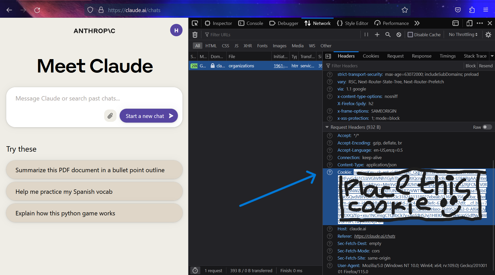

# Adapters

Free One API currently supports multiple LLM reverse engineering libraries, each channel supports a corresponding adapter, the adapter is responsible for converting the client's request into a reverse engineering library request, and converting the reverse engineering library's response into the client's response.

## acheong08/ChatGPT

ChatGPT official website reverse engineering library

### Configuration

1. Select `acheong08/ChatGPT` as `Adapter`


2. Go to `chat.openai.com` and log in to your account

3. Access `https://chat.openai.com/api/auth/session` directly in the browser, copy the `access_token` obtained


4. Enter in the `Config` column

```json
{
  "access_token": "your access token"
}
```

5. Save to test

### Reverse proxy

ChatGPT needs to use a reverse proxy to bypass Cloudflare's restrictions. The Free One API project defaults to the proxy address provided by the developer `https://chatproxy.rockchin.top/api/`, but the pressure is very high. It is strongly recommended to build a reverse proxy by yourself.

* You can build it using the following projects, if they are all unavailable, please find other reverse proxies by yourself:
  - https://github.com/flyingpot/chatgpt-proxy (Recommended)
  - https://github.com/acheong08/ChatGPT-Proxy-V4 (Unavailable)

Modify `adapters.acheong08_ChatGPT.reverse_proxy` to your reverse proxy address in `data/config.yaml`.
You can also directly enter in the `Config` column when creating the `acheong08/ChatGPT` adapter

```json
{
  "reverse_proxy": "your reverse proxy address"
}
```

Set the reverse proxy address used by this adapter.

> **WARNING**  
> The current reverse proxy may have [the situation of repeating the previous text](https://github.com/RockChinQ/free-one-api/issues/75)(CN), `free-one-api` will automatically delete duplicate content. If unexpected situations occur, please set `adapters.acheong08_ChatGPT.auto_ignore_duplicated` to `false` to disable this feature.

## KoushikNavuluri/Claude-API

Anthropic Claude official website reverse engineering library

### Configuration

1. Select `KoushikNavuluri/Claude-API` as `Adapter`

2. Log in to `claude.ai`, open `F12`, select the `Network` column, find any request, and copy the `Cookie` string in the request header



3. Enter in the `Config` column

```json
{
  "cookie": "your cookie"
}
```

## xtekky/gpt4free

xtekky/gpt4free integrates multiple LLM reverse engineering libraries of multiple platforms

### Configuration

1. Select `xtekky/gpt4free` as `Adapter`

2. No authentication required, just save

## Soulter/hugging-chat-api

huggingface.co/chat official website reverse engineering library

### Configuration

1. Register `HuggingFace` account

2. Select `Soulter/hugging-chat-api` as `Adapter`

3. Enter in the `Config` column

```json
{
  "email": "HuggingFace Email",
  "passwd": "HuggingFace Password"
}
```

## xw5xr6/revTongYi

Aliyun TongYi QianWen official website reverse engineering library

### Configuration

1. Select `xw5xr6/revTongYi` as `Adapter`

2. Go to <https://qianwen.aliyun.com/> and log in to your account

3. Refer to the configuration method of Claude above to obtain the `Cookie` string

4. Enter in the `Config` column

```json
{
  "cookie": "通义千问cookie"
}
```

## Zai-Kun/reverse-engineered-chatgpt

ChatGPT official website reverse engineering library, this is newer. acheong08/ChatGPT is no longer maintained.

### Configuration

1. Select `Zai-Kun/reverse-engineered-chatgpt` as `Adapter`

2. Go to`chat.openai.com` and log in to your account

3. Take the value of `__Secure-next-auth.session-token` from Cookies as `session_token`

4. Enter in the `Config` column

```json
{
  "session_token": "your session token"
}
```

## ds-webagent/deepseek-web

Expose a locally running DS_WebAgent as a channel. DS_WebAgent is the Rust bridge in ds_web_agent/: it drives a real (headed) browser on chat.deepseek.com and exposes an OpenAI-compatible API, so no cookie or session token is needed — but you must log in to DeepSeek once in that browser.

### Deployment

Start it together with the bundled docker-compose.dswebagent.yaml (recommended):

```bash
docker compose -f docker-compose.dswebagent.yaml up -d --build
```

Then:

1. Open http://localhost:16080/vnc.html and log in to DeepSeek in the Chromium inside the container (the login state persists in ./ds_webagent-data/browser-profile, so a restart does not require logging in again);
2. Open http://localhost:3000/ for this project’s admin page (default password 12345678);
3. Add channel -> Adapter: ds-webagent/deepseek-web -> Save -> Test.

### Configuration

```json
{
  "base_url": "http://ds-webagent:9178",
  "api_token": "local-dev-token",
  "default_model": "ds-web-search",
  "timeout_secs": 900
}
```

| Field | Meaning |
|---|---|
| base_url | DS_WebAgent address. Inside the compose network use http://ds-webagent:9178; running natively use http://127.0.0.1:9178 |
| api_token | Must match DS_WebAgent’s [server].api_token, otherwise 401 |
| default_model | Fallback when the client’s model name is not one of the three below |
| timeout_secs | Per-request timeout (web-edition replies are slow; default 900s) |

### Model names

DS_WebAgent knows exactly three model IDs, mapping to the combinations of the web page’s “web search / deep think” toggles:

| model id | Web search | Deep think |
|---|---|---|
| ds-web-search | on | off |
| ds-web-think | off | on |
| ds-web-search-think | on | on |

An unknown model name (e.g. gpt-4o) falls back to default_model instead of erroring.

### Tool calling (supported)

The tools / tool_choice fields are forwarded to DS_WebAgent as-is; when the model wants a tool this channel returns finish_reason: "tool_calls" and message.tool_calls, and the caller executes the tool:

1. Execute the tool, append {"role": "tool", "tool_call_id": "...", "content": "..."} to messages and request again;
2. The model continues from the tool result and finally returns finish_reason: "stop" with content.

DS_WebAgent carries one tool call per response, so message.tool_calls always has length 1.

### Hot config changes

The adapter re-reads its config on every request: edit the channel Config in the admin page and save; the next request uses it immediately, no container restart needed.

### Known limits

- DS_WebAgent is serial internally (max_concurrent_requests = 1), so concurrent requests queue; while DeepSeek is not logged in, /health returns ready: false and the channel is treated as unavailable — expected.
- The channel’s Test button only probes DS_WebAgent’s /health; it does not send a real conversation.
