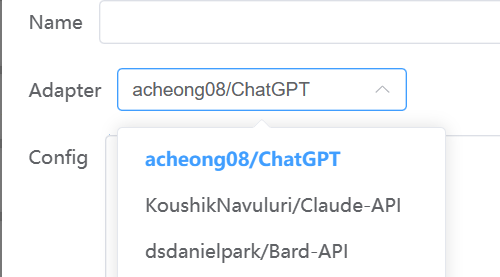
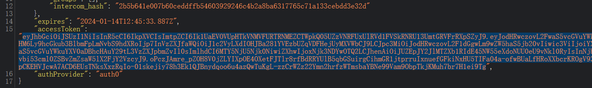

# 适配器

Free One API 目前支持多种 LLM 逆向工程库，每个渠道支持对应一个适配器，适配器负责将客户端的请求转换成逆向工程库的请求，并将逆向工程库的响应转换成客户端的响应。

## acheong08/ChatGPT

ChatGPT 官网逆向工程库

### 配置方式

1. 选择 `acheong08/ChatGPT` 作为 `Adapter`



2. 前往 `chat.openai.com` 登录账号

3. 直接在浏览器访问 `https://chat.openai.com/api/auth/session`, 复制得到的 `access_token`



4. 在 `Config` 栏中输入

```json
{
  "access_token": "你的access token"
}
```

5. 保存即可测试

### 反向代理

ChatGPT 需要通过反向代理才能绕过 Cloudflare 的限制，Free One API 项目默认使用开发者提供的代理地址 `https://chatproxy.rockchin.top/api/` ，但压力很大，强烈建议自行搭建反向代理。

* 可以根据以下项目搭建，若均不可用，请自行寻找其他反代:
  - https://github.com/flyingpot/chatgpt-proxy （推荐）
  - https://github.com/acheong08/ChatGPT-Proxy-V4 （不可用）

在`data/config.yaml`中修改`adapters.acheong08_ChatGPT.reverse_proxy`为你的反向代理地址即可。
也可以在创建 `acheong08/ChatGPT` 适配器时，直接在 `Config` 栏中输入

```json
{
  "reverse_proxy": "你的反向代理地址"
}
```

设置此适配器使用的反向代理地址。

> **WARNING**  
> 目前使用的反代可能存在[重复回复前文的情况](https://github.com/RockChinQ/free-one-api/issues/75)，`free-one-api` 会自动删除重复内容，若出现意想不到的情况，请设置`adapters.acheong08_ChatGPT.auto_ignore_duplicated`为`false` 以禁用此功能。

## KoushikNavuluri/Claude-API

Anthropic Claude 官网逆向工程库

### 配置方式

1. 选择 `KoushikNavuluri/Claude-API` 作为 `Adapter`

2. 登录 `claude.ai`, 打开 `F12`, 选择 `Network` 栏, 找到任意一个请求, 复制请求头中的 `Cookie` 字符串


3. 在 `Config` 栏中输入

```json
{
  "cookie": "你的cookie"
}
```

## xtekky/gpt4free

xtekky/gpt4free 整合了多个平台的 LLM 逆向工程库

### 配置方式

1. 选择 `xtekky/gpt4free` 作为 `Adapter`

2. 无需鉴权，直接保存即可

## Soulter/hugging-chat-api

huggingface.co/chat 官网逆向工程库

### 配置方式

1. 注册 `HuggingFace` 账号

2. 选择 `Soulter/hugging-chat-api` 作为 `Adapter`

3. 在 `Config` 栏中输入

```json
{
  "email": "HuggingFace 注册邮箱",
  "passwd": "HuggingFace 密码"
}
```

## xw5xr6/revTongYi

阿里云通义千问官网逆向工程库

### 配置方式

1. 选择 `xw5xr6/revTongYi` 作为 `Adapter`

2. 前往 <https://qianwen.aliyun.com/> 登录账号并确保可以正常对话

3. 参照上方 Claude 的配置方式，获取 `Cookie` 字符串

4. 在 `Config` 栏中输入

```json
{
  "cookie": "通义千问cookie"
}
```

## Zai-Kun/reverse-engineered-chatgpt

ChatGPT 官网逆向工程库，这个新一点。acheong08/ChatGPT 已经不维护了。

### 配置方式

1. 选择 `Zai-Kun/reverse-engineered-chatgpt` 作为 `Adapter`

2. 前往 `chat.openai.com` 登录账号

3. 从 Cookies 中取出 `__Secure-next-auth.session-token` 的值作为 `session_token`

4. 在 `Config` 栏中输入

```json
{
  "session_token": "你的session token"
}
```

## ds-webagent/deepseek-web

把本地运行的 DS_WebAgent 接成一个渠道。DS_WebAgent 是仓库里 ds_web_agent/ 目录下的 Rust 桥梁：它驱动一个真实的（有头）浏览器操作 chat.deepseek.com，对外暴露 OpenAI 兼容接口，因此不需要任何 cookie / session token，但需要你先在那个浏览器里手动登录一次 DeepSeek。

### 部署方式

用仓库根目录的 docker-compose.dswebagent.yaml 一起启动（推荐）：

```bash
docker compose -f docker-compose.dswebagent.yaml up -d --build
```


启动后：

1. 打开 http://localhost:16080/vnc.html，在容器里的 Chromium 中手动登录 DeepSeek（登录态持久化在 ./ds_webagent-data/browser-profile，之后重启容器不用再登）；
2. 打开 http://localhost:3000/ 进入本项目管理页（默认密码 12345678）；
3. 「添加渠道」→ 适配器选 ds-webagent/deepseek-web → 保存 → 点测试。

### 配置方式

```json
{
  "base_url": "http://ds-webagent:9178",
  "api_token": "local-dev-token",
  "default_model": "ds-web-search",
  "timeout_secs": 900
}
```


| 字段 | 说明 |
|---|---|
| base_url | DS_WebAgent 的地址。同一 compose 网络里用 http://ds-webagent:9178；非 Docker 部署时用 http://127.0.0.1:9178 |
| api_token | 必须与 DS_WebAgent 的 [server].api_token 一致，否则 401 |
| default_model | 客户端请求的模型名不在下面三个里时的兜底 |
| timeout_secs | 单次请求超时（网页对话较慢，默认 900 秒） |

### 模型名

DS_WebAgent 只认三个模型 ID，对应网页上「联网搜索 / 深度思考」两个开关的组合：

| model id | 联网搜索 | 深度思考 |
|---|---|---|
| ds-web-search | 开 | 关 |
| ds-web-think | 关 | 开 |
| ds-web-search-think | 开 | 开 |

客户端传别的模型名（如 gpt-4o）会落到 default_model，不会报错。

### 工具调用（已支持）

请求里的 `tools` / `tool_choice` 会原样转发给 DS_WebAgent；模型要调工具时，本渠道返回
`finish_reason: "tool_calls"` 与 `message.tool_calls`，**工具由调用方执行**：

1. 客户端执行完工具，把 `{"role":"tool","tool_call_id":"...","content":"..."}` 追加到 `messages` 再请求一次；
2. 模型基于工具结果继续，最终返回 `finish_reason: "stop"` 与 `content`。

DS_WebAgent 内部一次只承载一个工具调用，所以 `message.tool_calls` 数组长度为 1。

### 配置热修改

适配器每次请求都重新读取配置：在管理页改完渠道的 `Config` 并保存，下一次请求立即生效，不需要重启容器。

### 已知限制

- DS_WebAgent 内部串行（max_concurrent_requests = 1），并发请求会排队；心跳检测用的 /health 在 DeepSeek 未登录时返回 ready: false，渠道会被判为不可用，属正常现象。
- 渠道的「测试」按钮只探测 DS_WebAgent 的 /health，不会真的发一次对话。

## aeliusai/aelius-web

直接反代 <https://aeliusai.com/chat> 的网页对话。适配器只做网页 UI 同款请求，复用站点自己的游客会话、对话与 SSE 流式接口，不绕过验证码或 Cloudflare：

- `POST /api/v1/guest/session`：建立游客身份，不需要账号；
- `POST /api/v1/chats`：新建网页对话；
- `POST /api/v1/chats/{id}/stream`：发送一轮消息，SSE 增量返回；
- `POST /api/v1/chats/{id}/regenerate`：上一轮已提交但没答完时续跑。

默认游客身份即可用；填入已登录账号的 Cookie 可以获得更大的上下文（游客约 6k tokens，登录约 22k tokens，以站点实际额度为准）。

### 配置方式

1. 打开 http://localhost:3000/ 进入管理页，「添加渠道」→ `Adapter` 选 `aeliusai/aelius-web`；
2. 游客模式直接保存即可；需要登录态时在 `Config` 里填 Cookie：

```json
{
  "session_cookie": "ael_sb_id=...; aelius_did=...; aelius_session=...",
  "timeout_secs": 300
}
```

3. 保存后点「测试」，适配器会请求 `GET /api/v1/user` 探测身份是否可用（不会真的发一次对话）。

Cookie 的取法：在浏览器登录 aeliusai.com 后按 F12 → 网络 → 打开任意一个 `/api/v1/` 请求 → 复制完整的 `Cookie` 请求头。Cookie 只写入渠道配置（`data/free_one_api.db`，已 gitignore），不要提交到仓库或写进文档。

| 字段 | 说明 |
|---|---|
| session_cookie | 可选。留空时自动申请游客会话（24 小时有效）；填入登录账号的完整 Cookie 后固定使用该账号 |
| tools_enabled | 是否打开网页自身的联网/工具开关，默认 `false`；与客户端的 `tools` 无关 |
| timeout_secs | 单次回复超时，默认 300 秒（最小 30 秒） |
| max_cached_chats | 内存中最多缓存多少个网页对话用于多轮复用，默认 8 |
| base_url / user_agent | 一般不需要修改；仅用于站点自建反代或调试 |

渠道配置在每次请求时现取现用：管理页改完 `Config` 保存后，下一次请求立即生效，不需要重启容器。

### 模型名

适配器认 `aelius`、`aelius-web`、`aelius-chat` 三个模型 ID，推荐的客户端模型名是 `aelius`；上游站点实际使用的模型名不会暴露给客户端。客户端想用别的模型名，在渠道的 `model_mapping` 里映射到 `aelius` 即可。`/v1/models` 会按已启用渠道动态汇总 `model_mapping` 的键与适配器的 `supported_models()`。

### 多轮对话

网页对话的历史保存在 Aelius 服务端，客户端每次带来的 `messages` 只是回放。适配器的判据是：

1. 首条 `user` 消息与网页对话一致；
2. 客户端历史里回放的上一条 `assistant` 内容，正好是适配器上一轮返回的答复。

两条都满足时沿用同一个网页对话，只发送最后一条 `user` 消息；否则把整理后的完整历史（`System:` / `User:` / `Assistant:` / `Tool result:` 标签拼成一条消息）发进一个新网页对话。

上一轮消息已经提交给网页端、但没拿到答复时，下一次请求会调用网页的「重新生成」，而不是把同一条消息重复发一遍。对话索引只在内存里，最多保留 `max_cached_chats` 个。

### 流式输出与工具

- **流式输出**：支持。站点 SSE 里的 `content` 增量帧直接转成 OpenAI 流式分片，`done` / `stopped` 帧结束本轮。
- **工具调用**：不支持客户端的 `tools` / `tool_choice`，渠道能力里 `Function Call` 为 `❌`。`tools_enabled` 打开的是网页自身的联网/工具开关，不会产生 `tool_calls`。

### 错误码

上游失败时返回的错误 `code` 如下，便于在运行日志和管理页定位：

| code | HTTP | 含义 |
|---|---|---|
| aelius_rate_limited | 429 | 站点限流（约 12 次/分钟），稍后重试 |
| aelius_pool_full | 429 | 站点当前没有可用的上下文槽位，稍后重试 |
| aelius_context_full | 400 | 当前网页对话上下文已满，新开一段对话（或改用登录 Cookie） |
| aelius_auth_expired | 401 | 配置的 Cookie 已失效，更新 `session_cookie` |
| aelius_guest_session_failed | 502 | 游客会话创建失败 |
| aelius_unreachable | 502 | 连不上站点（网络或自建反代问题） |
| aelius_upstream_error | 502 | 站点返回非 2xx |
| aelius_bad_response | 502 | 新建对话的响应无法解析 |
| aelius_stream_broken / aelius_stream_incomplete | 502 | SSE 中断，或连接结束但没有 `done` 帧 |
| aelius_empty_reply | 502 | 本轮答复为空 |
| aelius_chat_gone | 502 | 网页对话已失效，重建后仍不可用 |
| aelius_attachment_not_supported | 400 | 消息里带了图片/文件等非文本附件 |
| aelius_empty_messages / aelius_unexpected_last_role | 400 | 请求没有可发送的消息，或最后一条不是 `user` |

### 已知限制

- 游客会话 24 小时有效，上下文较小；登录账号上下文更大；
- 游客会话与对话索引只存在内存里，重启 free-one-api 后重新建立；
- 同一渠道内的请求串行执行，避免同一个网页对话被并发写入；
- 只转发文本消息；站点限流时按 429 上报；
- 渠道「测试」只探测 `GET /api/v1/user`，不会真的发一次对话。
