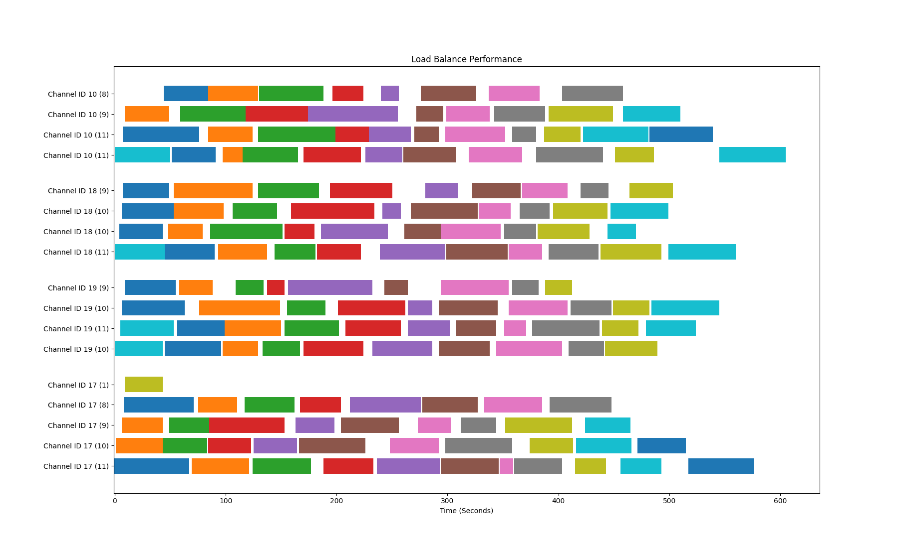

# Free One API 中文文档

把各种 LLM 逆向工程库 统一封装成标准 OpenAI API，一个地址、一个 key、一套协议。

放心大胆用，老佛爷已经付过钱了。

## 文档导航

| 页面 | 内容 |
|---|---|
| 部署 | Docker / Compose / 手动 / systemd / 反向代理 / 升级 |
| 使用 | 创建渠道与 Key、客户端接入、工具调用 |
| 适配器 | 各适配器的配置方式 |
| DS_WebAgent 接入 | DeepSeek 网页版渠道：部署、登录、配置、工具调用 |
| 配置文件 | data/config.yaml 全字段说明 |
| 常见问题 | 排错速查 |

## 三分钟上手

```bash
# 1. 起服务（Docker，含前端构建）
docker run -d --name free-one-api --restart always \
  -p 3000:3000 -v ~/free-one-api/data:/app/data rockchin/free-one-api
```

# 2. 打开管理页，创建渠道 + 创建 API Key
#    http://localhost:3000/   （默认密码 12345678）

# 3. 像用 OpenAI 一样用它
curl http://localhost:3000/v1/chat/completions \
  -X POST -H "Content-Type: application/json" \
  -H "Authorization: Bearer <你的 key>" \
  -d '{"model":"gpt-3.5-turbo","messages":[{"role":"user","content":"Hello!"}]}'


要接 DeepSeek 网页版（不需要 cookie，靠真实浏览器驱动），见 DS_WebAgent 接入。

## 支持的适配器

| Adapter | Multi Round | Stream | Function Call | 说明 |
|---|---|---|---|---|
| acheong08/ChatGPT | ✅ | ✅ | ❌ | ChatGPT 网页版 |
| KoushikNavuluri/Claude-API | ✅ | ❌ | ❌ | Claude 网页版 |
| dsdanielpark/Bard-API | ✅ | ❌ | ❌ | Google Bard 网页版 |
| xtekky/gpt4free | ✅ | ✅ | ❌ | 整合多个平台 |
| Soulter/hugging-chat-api | ✅ | ✅ | ❌ | HuggingFace 对话模型 |
| xw5xr6/revTongYi | ✅ | ✅ | ❌ | 阿里云通义千问网页版 |
| Zai-Kun/reverse-engineered-chatgpt | ✅ | ✅ | ❌ | ChatGPT 网页版（较新） |
| ds-webagent/deepseek-web | ✅ | ✅ | ✅ | 本仓库自带 DS_WebAgent（Rust + 真实浏览器）驱动的 DeepSeek 网页版，无需 cookie |

## 支持的 API 路径

- /v1/chat/completions

欢迎提交 issue 或 pull request 来添加更多的 LLM 库和 API 路径支持。

## 核心能力

- 自动负载均衡：多渠道打分选优，失败自动降级；
- Web UI：渠道、Key、日志全部图形化管理；
- 流式输出：标准 SSE 分片；
- 工具调用：tools / tool_choice 透传，tool_calls 按 OpenAI 规范返回（工具由调用方执行）；
- 心跳检测：渠道连续失败自动禁用，恢复后手动或自动启用；
- 运行日志：终端 + 数据库双写。

## 负载均衡性能

启用 4 个通道、客户端 16 个线程请求「write a quick sort in Java」的甘特图：
（通道标记为 Channel ID <id> <request count>，X 轴为秒，每色块一次请求）



## 社区

有问题、逆向交流、功能建议、参与贡献，加群：

- QQ 群①：（此群已满）
- QQ 群②：1091113674
- [Telegram](https://t.me/+qpeq4Ev9FuI0YjVl)
- [Discord](https://discord.gg/W44yRcG5b)

## 合规声明

本项目及其适配器只通过各站点网页的正常 UI 进行操作，不逆向私有接口、不绕过验证码 / 风控 / Cloudflare、不伪造浏览器指纹。请低频使用，仅作个人用途。
